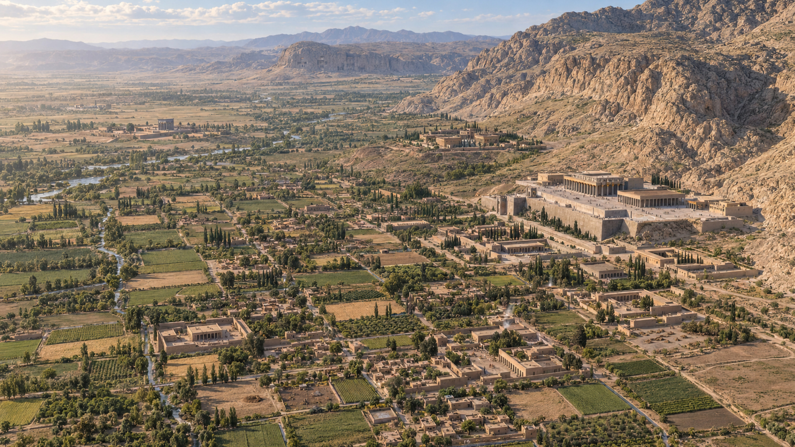

# Heritage Reconstruction Workflow

**史料 → 不确定性 → 空间模型 → AI 复原图 → 审查 → 离线交付。**

一个可审查的历史建筑复原工作流。v0.1.0 以波斯波利斯为完整制作案例，保留 11 幅结果、16 次实际生成/修改记录、原生图、弃用版本、提示词、空间模型与八项过程经验。

本项目提供工作流和工具，不提供“考古准确率”。万国门守护兽等部分图像细部仍有已知限制；技术复现通过不等于历史正确。

独立检查还更正了一条原制作诊断：PP04 的保留前后图都已有牛头特征，原先“人头改成牛头”的说法缺乏图像支持。旧记录和图片保留，当前解释见 [制作记录勘误](docs/ERRATA.md)。



## 下载与文档

- [v0.1.0 下载页](https://github.com/jeromezhang4-lang/heritage-reconstruction-workflow/releases/tag/v0.1.0)：完整项目、两个 skills 的轻量分享包、可直接打开的离线 HTML 和 SHA256 校验文件。
- [技能安装与调用](docs/SKILLS.md) · [完整复现方法](docs/REPRODUCIBILITY.md) · [从新遗址开始](docs/WORKFLOW.md) · [验收范围](validation/ACCEPTANCE.md)。
- [跨平台 CI](https://github.com/jeromezhang4-lang/heritage-reconstruction-workflow/actions/workflows/reproduce.yml)：Linux、macOS、Windows 已完成公开下载、17 项测试和两个技能的独立运行。[查看实际通过的运行](https://github.com/jeromezhang4-lang/heritage-reconstruction-workflow/actions/runs/38719542220)。
- 代码和技能工具：MIT；第一方案例说明与生成图：在权利持有范围内 CC BY 4.0。第三方地图不随包分发。

## 三分钟离线运行

需要 **Python 3.9 或更高版本**。核心路线只有标准库，无须 pip、账号、API key、Blender 或原作者电脑目录。

克隆完整仓库，然后执行：

```bash
git clone https://github.com/jeromezhang4-lang/heritage-reconstruction-workflow.git
cd heritage-reconstruction-workflow
python3 scripts/heritage.py verify --case cases/persepolis
python3 scripts/heritage.py reproduce --case cases/persepolis --out build/persepolis
```

不使用 Git 时，从下载页取得 `Heritage_Reconstruction_Workflow_v0.1.0.zip`，解压后在项目根目录执行最后两条 Python 命令。只想查看结果，可以直接下载并打开 `Heritage_Workflow_Demo.html`。

Windows 可以使用 `py -3` 替代 `python3`。打开 `build/persepolis/gallery.html`，即可离线查看结果、修改前后对照、证据边界和可旋转模型。生成的 `case-release.zip` 是本次重建的展馆与模型包；完整原生图和研究记录在项目的 `cases/persepolis/recorded/`。

命令失败会返回非零退出码；不要把错误状态当作成功。输出目录须为空或带有本工具创建的本案例标记，避免覆盖无关文件。

## “跑通”具体指什么

上述命令会检查证据与文件关系，从可移植配方重新生成核心/区域模型、相机和 SVG 机位预览，再使用已保存的生成图重建独立 HTML，最后校验 ZIP 的 CRC、成员哈希与磁盘文件。

它**不会重新调用 AI 生图**，也不会重新下载外部论文或考古图。原生生成使用的服务型号/seed 未完整暴露，无法保证未来逐像素重现；既有超分图在此路线中作为已记录结果回放。

- 核心 OBJ 可与原始制作记录比较；浮点 JSON/区域派生可能存在记录精度范围内的差异。
- SVG 是投影物体包络的机位预览，不是深度图或发掘测绘。原始结构/深度/边缘 PNG 已保留；可选栅格渲染见下文。
- 历史准确性、全部图像与模型严格吻合、专业考古认证，均不由这两条命令证明。

详见 [独立复现说明](docs/REPRODUCIBILITY.md) 和 [波斯波利斯案例](cases/persepolis/README.md)。

## 制作一个新遗址案例

```bash
python3 scripts/heritage.py init --out work/my-site --id my-site
```

这是有意保持不完整的研究草稿。按 [新案例流程](docs/WORKFLOW.md) 替换占位来源，记录年代、证据、未知项与几何参数，再依次执行结构检查、冻结和 `prepare`。获取生图工具的真实输出后，用 `record-generation` 留存输入和结果，用 `record-review` 记录图像审查。未经处理的 `FAIL` 会阻止构建。

想先练习命令而不虚构古代遗址：

```bash
python3 scripts/heritage.py init --out work/synthetic --id synthetic --demo
python3 scripts/heritage.py reproduce --case work/synthetic --out build/synthetic
```

这个很小的合成样例仅测试软件，图像不是 AI 生成，也没有历史含义。

## 可直接分享的 skills

`skills/` 内有两个自包含技能，不需要先安装本项目：

- **heritage-reconstruct**：研究、证据分层、建模准备、真实生图交接、修正及案例交付。
- **heritage-audit**：检查一个案例的来源关联、文件、已知失败与尚未验证的历史判断，生成审核报告。

使用方式和明确调用示例见 [技能分享与安装](docs/SKILLS.md)。它们各自带有标准库运行工具与合成练习入口；完整波斯波利斯素材保留在项目中，以免每个技能重复打包大型图像。

例如，在 macOS/Linux 将两个技能复制到自己的 Codex 用户目录：

```bash
python3 scripts/install_skills.py --destination "$HOME/.agents/skills"
```

这是使用者主动执行的安装命令；工具不会覆盖已有同名技能。桌面端可输入 `@` 选择技能，Codex CLI/IDE 可输入 `$heritage-reconstruct` 或 `$heritage-audit`。项目范围安装、Windows 命令和仓库外练习见技能文档。

## 可选：重新渲染 PNG 参考图

只有这条可选路线需要第三方包。在虚拟环境安装 `requirements-render.txt` 后：

```bash
python3 scripts/heritage.py render-raster --build build/persepolis --scene PP01 --out build/raster-PP01
```

会从实际网格生成 Structure / Depth / Edges PNG 和独立记录，单图默认截止 120 秒。见 [复现范围与可选依赖](docs/REPRODUCIBILITY.md)。

## 项目结构

```text
heritage_workflow/        标准库核心、可选栅格渲染器、离线展馆
cases/persepolis/        标准化案例、可移植配方、原始结果与历史过程代码
schemas/                可公开讨论的数据格式
skills/                 两个自包含 SKILL.md 技能
docs/                   工作流、复现边界、失败记录、素材许可
tests/                  有效路径与故障注入测试
validation/             本版实际执行的验收证据及范围
```

运行测试：`python3 -m unittest discover -s tests -v`。

## 许可与来源

第一方代码及技能工具使用 [MIT](LICENSE)。第一方研究说明、案例数据和生成图在权利持有范围内使用 [CC BY 4.0](LICENSE-CONTENT.md)。第三方考古底图不在公开包内；[素材说明](docs/RIGHTS.md) 与案例 `external_assets` 保留其出处、原始哈希和不随包分发的原因。

现有数字遗产研究已有证据透明和过程文档规范。这个项目的目标是把这些原则落实到 AI 制作中，而不是声称发明了虚拟考古或以生成图取代考古研究。参见 [方法与参考](docs/METHOD.md)。

## English

An auditable workflow connecting historical sources, explicit uncertainty, reference geometry, AI images, review and offline delivery. The stdlib-only quickstart regenerates reference geometry and rebuilds an offline Persepolis gallery using preserved images. It does **not** rerun the original AI service, establish historical accuracy, or certify image/mesh correspondence. The complete case retains 11 views, 16 generation/edit stages and unsuccessful versions. Two standalone agent skills are included. See [reproducibility](docs/REPRODUCIBILITY.md) for the exact tested scope.
